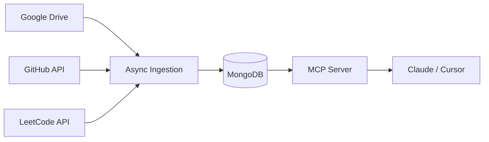

# MyMCP

A Model Context Protocol (MCP) server that connects AI assistants (Claude, Cursor) directly to my live developer profile.

Ingests and indexes credentials from my Resume, GitHub and LeetCode for search, automated job fit evaluation, and tailored interview prep.

## Architecture

## Features

- **Resume & Experience Search**: Full querying across projects, skills, and work history.
- **Project Deep Dives**: Live repository metrics, languages, and README insights.
- **DSA Proficiency**: Problem solving breakdown by difficulty, contest ratings, and topic mastery.
- **Job-Fit Scoring**: Automated evaluation against any job description with direct proof points.
- **Interview Prep**: Tailored scenario questions and role-specific candidate pitches.
- **Consolidated Skills Matrix**: Unified multi-source mapping cross-referencing claims, across all data sources.
- **Developer Profile Roast**: Lighthearted, witty critique analyzing commits, difficulty ratios, and tech choices.

## Tech Stack

- **Framework**: FastMCP
- **Database**: MongoDB
- **Ingestion**: Async REST & GraphQL APIs and PyPDF parsing